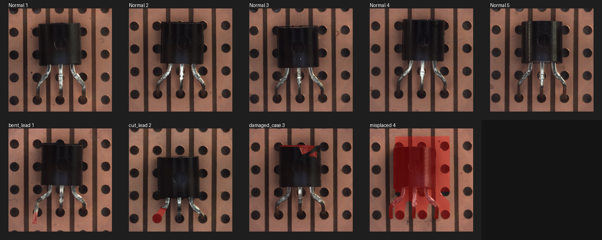
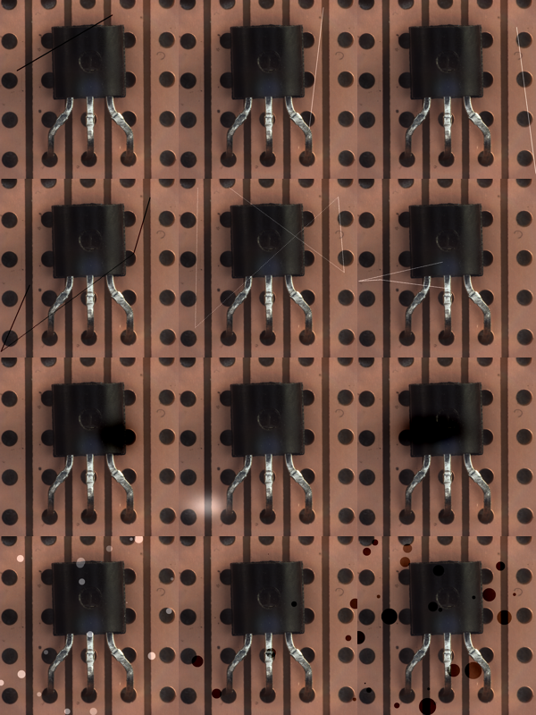
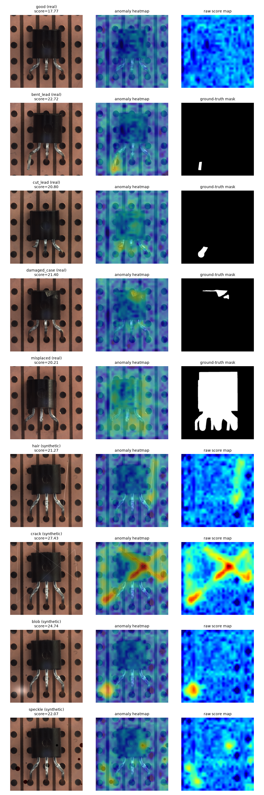

# End-to-End Technical Documentation

**Project:** Visual anomaly detection for chip / package inspection with PatchCore
**Companion to:** [README.md](../README.md) (summary, screenshots and results)

This document explains *what* was built, *why* each decision was made, *how* every part works, *what* the outputs were, and *what went wrong along the way*. It is written so that someone can reproduce the work and defend each step.

---

## Table of contents

1. [Problem statement](#1-problem-statement)
2. [Why unsupervised anomaly detection](#2-why-unsupervised-anomaly-detection)
3. [Dataset](#3-dataset)
4. [Environment setup](#4-environment-setup)
5. [Method: PatchCore](#5-method-patchcore)
6. [Code walkthrough](#6-code-walkthrough)
7. [Synthetic defect generator](#7-synthetic-defect-generator)
8. [Evaluation protocol and metrics](#8-evaluation-protocol-and-metrics)
9. [Step-by-step run log and outputs](#9-step-by-step-run-log-and-outputs)
10. [Reading the heatmaps](#10-reading-the-heatmaps)
11. [Issues found and fixed](#11-issues-found-and-fixed)
12. [Comparison with the PatchCore paper](#12-comparison-with-the-patchcore-paper)
13. [Limitations](#13-limitations)
14. [Future work](#14-future-work)
15. [Reproduction checklist](#15-reproduction-checklist)
16. [Glossary](#16-glossary)
17. [References](#17-references)

---

## 1. Problem statement

High-resolution photographs are taken of microprocessor packages between manufacturing operations. The goal is to automatically flag images where something is wrong, for example:

- a **foreign object** on the package — a strand of human hair, dust, sand particles;
- a **crack** on the surface;
- **too much adhesive** (gum) applied where a fixed quantity is expected.

In production there are around ten anomaly types, but the task asks for a representative subset. Real factory images could not be shared, so any suitable public image dataset could be used, as long as the intent — **detecting anomalies in images** — is preserved.

## 2. Why unsupervised anomaly detection

A normal supervised classifier ("good" vs "hair" vs "crack" …) needs many labelled examples of every defect type. In manufacturing this is impractical:

- defects are **rare** (a good line produces very few of them);
- defects are **open-ended** — a new kind of contamination can appear at any time;
- labelling pixel-accurate masks is **expensive**.

Good parts, on the other hand, are plentiful. So the problem is framed as **one-class / cold-start anomaly detection**: learn what "normal" looks like from good images only, then flag anything that deviates. This automatically covers defect types never seen before, including all ten production anomaly types, without collecting examples of each.

PatchCore was chosen because it is one of the strongest published methods for exactly this setting on the MVTec AD benchmark, needs **no training** (only a pretrained feature extractor), and produces both an **image-level decision** and a **pixel-level heatmap** showing *where* the defect is — essential for an operator who must verify it.

## 3. Dataset

**MVTec AD — `transistor` category** ([Bergmann et al., CVPR 2019](https://www.mvtec.com/company/research/datasets/mvtec-ad)). Licence CC BY-NC-SA 4.0 (non-commercial; see `data/raw/transistor/license.txt`).

Chosen because it is the standard public benchmark for industrial visual inspection and its transistor images — a black moulded body with metal leads, top-down, 1024×1024 RGB — are the closest public analogue to a chip package.

| Split | Folder | Count | Labels |
|---|---|---:|---|
| Train | `train/good` | 213 | good only |
| Test | `test/good` | 60 | good |
| Test | `test/bent_lead` | 10 | defect + pixel mask |
| Test | `test/cut_lead` | 10 | defect + pixel mask |
| Test | `test/damaged_case` | 10 | defect + pixel mask |
| Test | `test/misplaced` | 10 | defect + pixel mask |
| **Test total** | | **100** | 60 good / 40 defective |

The training set contains **no defects** — the model never sees a defect before testing.

Location: `data/raw/transistor/` (configured in `src/config.py`; override with the `ANOMALY_DATA_DIR` environment variable). The dataset is excluded from git by `.gitignore`.


*Top row: normal transistors. Bottom row: one example of each real defect, ground-truth mask in red.*

## 4. Environment setup

### 4.1 Windows DLL issue

The first attempt used the machine-wide PyTorch install and failed with:

```text
OSError: [WinError 1114] A dynamic link library (DLL) initialization routine failed.
Error loading ... torch\lib\c10.dll
```

This was fixed by creating an isolated virtual environment and installing CPU builds of the packages into it.

### 4.2 Setup commands

```powershell
python -m venv venv
.\venv\Scripts\python -m pip install --upgrade pip
.\venv\Scripts\python -m pip install -r requirements.txt
.\venv\Scripts\python scripts\print_env.py
```

### 4.3 Environment used for the reported results

Output of `scripts/print_env.py`:

```text
OS: Windows-11-10.0.26200-SP0
Python: 3.12.3
Torch: 2.14.1+cpu
CUDA available: False
TorchVision: 0.29.1+cpu
Scikit-learn: 1.9.1
NumPy: 2.5.4
Pillow: 13.0.0
```

Everything runs on CPU. The WideResNet50 ImageNet weights (`wide_resnet50_2-9ba9bcbe.pth`) are downloaded automatically by torchvision on first use and cached under `~/.cache/torch/hub/checkpoints`.

## 5. Method: PatchCore

Reference: Roth et al., *Towards Total Recall in Industrial Anomaly Detection*, CVPR 2022 ([arXiv:2106.08265](https://arxiv.org/abs/2106.08265)).

### 5.1 Intuition

A pretrained CNN already knows how to describe local image content (edges, textures, shapes) as feature vectors. If we collect the feature vectors of **every small patch of every good image**, we get a "dictionary of normal". At test time, any patch whose feature vector is **far from every entry in that dictionary** is something the model has never seen on a good part — an anomaly.

### 5.2 Pipeline

```
image (1024×1024) ─► resize 256×256 ─► ImageNet normalisation
      │
      ▼
WideResNet50 (frozen) ── layer2 ─► 512 × 32 × 32 ──► 3×3 avg-pool ─┐
                       └─ layer3 ─► 1024 × 16 × 16 ─► 3×3 avg-pool ─► bilinear ↑ 32×32 ─┤
                                                                                         ▼
                                                              concat ─► 1536 × 32 × 32
                                                                         │
                                                                         ▼
                                                          1024 patch vectors of 1536 dims
```

**Training (memory bank):**
1. Extract the 1024 patch vectors from each of the 213 good training images → 218 112 vectors.
2. Reduce them to **512** vectors with greedy coreset subsampling (§5.4). This is the memory bank 𝓜.

**Testing:**
1. Extract the 1024 patch vectors of the test image.
2. For each patch vector *p*, compute *s(p) = min over m in 𝓜 of ‖p − m‖₂* — the distance to its nearest normal patch.
3. **Image score** = max over patches of *s(p)*. One very abnormal patch is enough to flag the image.
4. **Heatmap** = the 32×32 grid of *s(p)*, bilinearly upsampled to 256×256.

### 5.3 Why these design choices

| Choice | Reason |
|---|---|
| Pretrained, frozen backbone | No defect labels exist to train on; ImageNet features transfer well to industrial textures. |
| Mid-level layers (2 + 3) | Layer 1 is too low-level (edges only); layer 4 is too specialised to ImageNet object classes and too coarse (8×8). The paper finds layer 2+3 optimal. |
| 3×3 neighbourhood averaging | Gives each patch a little spatial context, making features robust to small misalignments. Paper's default patch size p = 3. |
| Upsample layer3 to layer2 size | Keeps the higher 32×32 resolution for localisation while adding layer3's richer semantics. |
| Max patch distance as image score | A defect usually occupies a small region; averaging over the image would dilute it. |
| Coreset subsampling | 218k × 1536 floats ≈ 1.3 GB and very slow nearest-neighbour search. A coreset keeps coverage of the normal feature space with ~0.2 % of the vectors. |

### 5.4 Greedy coreset subsampling

Goal: pick a small subset of vectors that **covers** the full set — every original vector should be close to some selected vector.

```
selected = [vector 0]
min_dist[i] = distance(vector i, vector 0)        for all i
repeat until |selected| = target_size:
    next = argmax_i min_dist[i]                    # the vector worst covered so far
    selected.append(next)
    min_dist = min(min_dist, distance(all, next))  # update coverage
```

The implementation keeps a running `min_dist` vector and only computes distances to the newly added vector each iteration, so each step costs O(N·d) instead of recomputing distances to all selected vectors (O(N·k·d)).

This is the same greedy *k*-center algorithm used in the paper (Algorithm 1), without the paper's random projection speed-up.

## 6. Code walkthrough

| File | Responsibility |
|---|---|
| `src/config.py` | `PROJECT_ROOT`, `DATA_ROOT` (= `data/raw` or `$ANOMALY_DATA_DIR`) |
| `src/dataset_loader.py` | Finds categories, train/test images, defect types and matching ground-truth masks; `describe_dataset()` returns counts |
| `src/patchcore.py` | The model (see below), plus `collect_test_items()`, `image_auroc()`, `pixel_auroc_from_heatmaps()` |
| `src/synthetic_defects.py` | `generate_defect_mask()`, `apply_defect()`, `generate_synthetic_dataset()` |
| `scripts/check_dataset.py` | Prints counts and defect types |
| `scripts/contact_sheet.py` | Builds the normal/defect overview image |
| `scripts/run_patchcore_baseline.py` | Full real-defect evaluation (image + pixel AUROC) |
| `scripts/generate_synthetic_defects.py` | Generates synthetic defects and evaluates clean-vs-synthetic AUROC |
| `scripts/visualize_heatmaps.py` | Produces the heatmap screenshot |
| `scripts/print_env.py` | Prints library versions |
| `tests/test_synthetic_defects.py` | 4 unit tests |

### `PatchCoreModel` (src/patchcore.py)

| Method | What it does |
|---|---|
| `_build_backbone()` | Loads `wide_resnet50_2` with `IMAGENET1K_V2` weights, freezes all parameters. **Raises an error** instead of silently using random weights if loading fails. |
| `_preprocess()` | RGB → resize 256×256 → tensor → ImageNet mean/std normalisation. |
| `_forward_features()` | Runs conv1 → layer1 → layer2 → layer3 and returns layer2 and layer3 outputs. |
| `extract_patch_vectors()` | 3×3 average pooling on both, upsample layer3 to 32×32, concatenate → 1024 × 1536 patch matrix. |
| `build_memory_bank()` | Stacks patch vectors of all normal images and applies `greedy_coreset()`. |
| `greedy_coreset()` | Greedy k-center selection (§5.4). |
| `score_image()` | `torch.cdist` to the memory bank, min over bank → per-patch scores; max → image score. |
| `heatmap_from_scores()` | Reshape to 32×32 and bilinearly upsample. |

## 7. Synthetic defect generator

The real dataset does not contain the defects named in the problem statement (hair, dust, adhesive). To test those scenarios, `src/synthetic_defects.py` draws them onto **good training images** and saves an exact pixel mask for each.

| Type | Simulates | How the mask is drawn |
|---|---|---|
| `hair` | Strand of hair / fibre | One straight line from a random point at a random angle, length 20–70 % of the image width (min 80 px), 3 or 5 px thick |
| `crack` | Surface crack | 3–6 connected straight segments between random points (a branching polyline), 3 or 5 px thick |
| `speckle` | Dust / sand particles | 5–30 filled circles, radius 2 px up to ~¼ of the base length, random intensity 0.5–1.0 |
| `blob` | Excess adhesive / stain | One soft Gaussian ellipse with random radii 4–18 % of the image size |

Aliases: `line → hair`, `scratch → crack`, `dust`/`particle → speckle`, `stain`/`spot`/`patch → blob`.

**Applying a defect:** `apply_defect()` adds (bright variant) or subtracts (dark variant) `mask × (50 + 140 × intensity)` from every RGB channel, then clips to [0, 255]. Bright or dark is chosen at random, 50/50. Only pixels inside the mask are changed (this is checked by a unit test).

**Difficulty levels:** `easy`, `medium`, `hard` scale the defect size by 0.75 / 1.0 / 1.35, and the intensity is `0.3 + 0.5 × ((idx mod 3) / 2) + (0.2 if hard else 0.1)`.

**Generated set:** 8 source images × 3 difficulty levels × 4 types = **96 images**, plus 96 masks, in `experiments/synthetic_defects/transistor/{hair,crack,blob,speckle}/`. File names: `<source>_<type>_<difficulty>_<idx>.png` and `..._mask.png`. Seed 42.


*Rows: hair, crack, blob, speckle. Columns: easy, medium, hard.*

## 8. Evaluation protocol and metrics

### 8.1 AUROC

The model outputs a **score**, not a yes/no answer. **AUROC** (area under the ROC curve) measures how well the scores *rank* defective above normal, across every possible threshold:

- **1.0** — every defective sample scores higher than every normal one (perfect ranking);
- **0.5** — random guessing.

Equivalently, AUROC is the probability that a randomly chosen defective sample gets a higher score than a randomly chosen normal one. It is the standard metric on MVTec AD and does not require choosing a threshold.

### 8.2 The three evaluations

| Evaluation | Positives | Negatives | Memory bank | Script |
|---|---|---|---|---|
| **Image AUROC** (real) | 40 defective test images | 60 good test images | all 213 train images, coreset 512 | `run_patchcore_baseline.py` |
| **Pixel AUROC** (real) | defect pixels in GT masks | all other pixels (incl. every pixel of good images) | same | `run_patchcore_baseline.py` |
| **Synthetic AUROC** | 96 synthetic defect images | 16 good test images | first 80 train images, coreset 256 | `generate_synthetic_defects.py` |

For pixel AUROC, masks and heatmaps are compared at 256×256 resolution; all 100 test images contribute (6.5 million pixels).

There is **no overlap** between training and evaluation images in the real evaluation: the memory bank uses `train/good`, scoring uses `test/`. In the synthetic evaluation, the synthetic images are built from the first 8 *training* images, which are also in the memory bank — but only their unmodified patches match the bank, so this does not help the defect regions get a low score.

## 9. Step-by-step run log and outputs

All raw outputs are saved under [`docs/run_logs/`](run_logs/).

### Step 1 — Dataset validation

```powershell
.\venv\Scripts\python scripts\check_dataset.py
```
```text
Dataset root: ...\Anomaly detection\data\raw
Detected categories: ['transistor']

Category: transistor
  train_count=213
  test_count=100
  defect_types=['bent_lead', 'cut_lead', 'damaged_case', 'misplaced']
```

### Step 2 — Visual QA

```powershell
.\venv\Scripts\python scripts\contact_sheet.py
```
Output: `results/contact_sheet_transistor.png` (copied to `docs/images/`). Confirms images and masks load and line up.

### Step 3 — Feature-extraction sanity check

A quick check with 10 training images and a coreset of 256 confirmed the shapes and that scoring runs:
```text
mem_shape (256, 1536)
sample_score 16.839820861816406
```

### Step 4 — Real-defect evaluation (main result)

```powershell
.\venv\Scripts\python scripts\run_patchcore_baseline.py
```
```text
Loading pretrained WideResNet50 backbone...
Train images: 213
Stage2 shape: (512, 32, 32)
Stage3 shape: (1024, 16, 16)
Patch vector count: 1024
Memory bank shape: (512, 1536)
Evaluation items: 100
Image AUROC: 0.9979
Pixel AUROC: 0.9314
PatchCore baseline evaluation complete.
```
Wall-clock time: **10 min 24 s** on CPU.

**Interpretation:** an image AUROC of 0.9979 means that out of the 60 × 40 = 2400 (good, defective) pairs, only about 5 pairs are ranked the wrong way. Pixel AUROC 0.9314 means the heatmap mostly highlights the right region, but localisation is less precise than detection — expected, since the score map is only 32×32 before upsampling.

### Step 5 — Synthetic defect evaluation

```powershell
.\venv\Scripts\python scripts\generate_synthetic_defects.py
```
```text
Generated synthetic files: 96
Synthetic defect types: ('blob', 'hair', 'crack', 'speckle')
Image AUROC on clean-vs-synthetic: 1.0000
```
Wall-clock time: **3 min 11 s** on CPU.

Breakdown by type and difficulty (each cell: 8 defect images vs 16 good images):

| Defect | Easy | Medium | Hard |
|---|---:|---:|---:|
| hair | 1.000 | 1.000 | 1.000 |
| crack | 1.000 | 1.000 | 1.000 |
| speckle | 1.000 | 1.000 | 1.000 |
| blob | 1.000 | 1.000 | 1.000 |

**Interpretation:** every synthetic defect is ranked above every clean image. This shows the pipeline reacts to all four problem-statement defect types, but it also shows that the synthetic defects are **too easy to be a discriminating test** (see §13).

### Step 6 — Heatmap visualisation

```powershell
.\venv\Scripts\python scripts\visualize_heatmaps.py
```
```text
good (real)                  score=17.769
bent_lead (real)             score=22.717
cut_lead (real)              score=20.802
damaged_case (real)          score=21.397
misplaced (real)             score=20.208
hair (synthetic)             score=21.266
crack (synthetic)            score=27.434
blob (synthetic)             score=24.739
speckle (synthetic)          score=22.068
```



### Step 7 — Unit tests

```powershell
.\venv\Scripts\python -m unittest discover -s tests
```
```text
....
----------------------------------------------------------------------
Ran 4 tests in 0.028s

OK
```

| Test | Checks |
|---|---|
| `test_generate_defect_mask_shape_and_nonzero_pixels` | Mask has the requested shape and is not empty |
| `test_apply_defect_changes_only_masked_pixels` | Image changes, and only where the mask is non-zero |
| `test_greedy_coreset_toy_example` | On 1-D points {0,1,2,10,11,20}, a 4-point coreset selects {0,2,10,20} — computed by hand |
| `test_hand_computed_auroc` | AUROC of a small example equals the hand-computed 5/6 |

## 10. Reading the heatmaps

All rows of the heatmap figure use **one shared colour scale**, so colours are comparable between images: blue = close to normal, red = far from anything normal.

| Row | Observation |
|---|---|
| good | Almost entirely blue — no false alarm. Image score 17.8, lowest in the figure. |
| bent_lead | Hot spot on the bent left lead, matching the GT mask. |
| cut_lead | Warm region at the lower left lead where it is cut. |
| damaged_case | Hot spot on the chipped top-right corner of the case, matching the GT mask. |
| misplaced | Weak, spread-out response. The whole transistor is shifted/rotated, so no single patch is extremely abnormal — this is the hardest real class for a patch-based method. |
| hair | Response follows the thin hair line, but weakly (score 21.3). Thin, low-area defects give the smallest margin. |
| crack | Strong response along the entire crack, strongest at intersections (score 27.4). |
| blob | Clear, compact hot spot at the adhesive blob (score 24.7). |
| speckle | Individual particles light up as small spots. |

## 11. Issues found and fixed

| # | Issue | Effect | Fix |
|---|---|---|---|
| 1 | Machine-wide PyTorch failed with `WinError 1114` (DLL init) | Nothing could run | Isolated virtual environment with CPU builds |
| 2 | If the pretrained weights failed to load, the backbone silently fell back to **random weights** | Results would be meaningless without any warning | `_build_backbone()` now raises an error instead |
| 3 | `greedy_coreset()` recomputed distances to *all* selected vectors each iteration | Very slow on 218k vectors | Keep a running `min_dist` and only compute distances to the newly selected vector |
| 4 | `pixel_auroc_from_heatmaps()` mixed heatmap values and mask values into the same score list and used image labels for every pixel | Pixel AUROC from this helper was wrong | Use mask values as labels and heatmap values as scores |
| 5 | `generate_synthetic_dataset()` saves `*_mask.png` next to each defect image, and the evaluation loop scored **every** `.png` in the folder — so 96 masks were scored as "defect images" | Synthetic AUROC was computed on 232 "defects", of which 96 were masks (trivially anomalous) and 40 were stale files; reported 0.9954 was not trustworthy | Skip files whose name ends in `_mask` |
| 6 | Output folders from an older generator version (`line`, `scratch`, `stain`, and old-format files in `blob`/`speckle`) were still on disk and were also scored | Mixed old and new defects in one number | Removed stale outputs; each type now has exactly 24 images + 24 masks |
| 7 | First heatmap figure normalised every row to its own min/max | The **good** image looked red everywhere — visually suggesting a false alarm | One shared colour scale (1st percentile → global max) for all rows |

Issues 5–7 were found by inspecting the screenshots and file counts rather than trusting the metric — the wrong synthetic AUROC looked plausible.

## 12. Comparison with the PatchCore paper

| Component | Paper | This implementation |
|---|---|---|
| Backbone | WideResNet50, ImageNet | ✅ same |
| Feature layers | layer2 + layer3 | ✅ same |
| Local aggregation | patch size p = 3 | ✅ 3×3 average pooling |
| Feature resolution | upsample to layer2 size | ✅ same |
| Memory bank | greedy coreset | ✅ greedy coreset |
| Coreset size | 1–10 % of all patches | ⚠️ fixed 512 (≈ 0.2 %) |
| Random projection for coreset | yes | ❌ exact distances |
| Input | resize 256, centre-crop 224 | ⚠️ resize 256, no crop |
| Image score | max patch distance, re-weighted (Eq. 7) | ⚠️ max patch distance, no re-weighting |
| Heatmap smoothing | Gaussian, σ = 4 | ❌ none |

The image AUROC obtained (0.9979) is in the same range as the paper's average image AUROC over MVTec AD (≈ 99 %) despite the simplifications (note: that is an average over all 15 categories, not a like-for-like transistor comparison). The missing Gaussian smoothing and the small coreset are the most likely reasons the pixel AUROC (0.9314) is lower than the paper's.

## 13. Limitations

1. **Domain gap.** Results are on MVTec transistors, not Intel package images. Package surfaces (mould compound, lids, substrates, die) have different textures and defect appearances.
2. **Adhesive excess is only approximated.** A soft dark/bright blob is not the same as a glue bead that is slightly wider than specified; that would be a subtle *shape* change at an expected location.
3. **Synthetic defects are too easy.** Strong contrast (± 50–190 intensity levels) makes every one detectable; real hair or dust may be much fainter. AUROC = 1.0 at every difficulty means the difficulty levels do not actually separate easy from hard cases.
4. **Small synthetic evaluation:** 96 defects vs 16 good images; a single extra false positive would change the score noticeably.
5. **No operating threshold.** AUROC measures ranking only. A deployed system must fix a threshold and report miss rate and false-alarm rate.
6. **Resolution.** Images are downscaled from 1024 to 256 and the score map is 32×32, so each heatmap cell covers about 32×32 original pixels. Very small defects (a fine hair, a single dust grain) can be diluted.
7. **Global defects.** Patch-based scoring is weakest when the whole object is subtly wrong (e.g. `misplaced`), because no single patch looks strange.
8. **Speed.** CPU only, exact nearest-neighbour search.

## 14. Future work

1. Add the missing paper components: Gaussian smoothing (σ = 4), 1 % coreset with random projection, centre crop, re-weighted image score.
2. **Higher resolution / tiling** — score 1024×1024 images in overlapping tiles so hair and dust keep more pixels.
3. **Harder, more realistic synthetic defects** — low-contrast hair with slight curvature and blur, cracks that follow texture, adhesive modelled as an enlarged existing glue line; then report AUROC as a function of contrast.
4. **Threshold selection** on a held-out validation set, reporting precision / recall and false alarms per 1000 parts.
5. **Per-defect-type real metrics** and more MVTec categories (e.g. `screw`, `metal_nut`, `grid`) to check generalisation.
6. **FAISS** nearest-neighbour search (already in `requirements.txt`) and GPU inference for line-rate speed.
7. If real images become available: a small labelled validation set of the ten production defect types.

## 15. Reproduction checklist

```powershell
python -m venv venv
.\venv\Scripts\python -m pip install --upgrade pip
.\venv\Scripts\python -m pip install -r requirements.txt
# place MVTec AD transistor in data\raw\transistor
.\venv\Scripts\python scripts\check_dataset.py
.\venv\Scripts\python scripts\contact_sheet.py
.\venv\Scripts\python scripts\run_patchcore_baseline.py       # expect Image 0.9979 / Pixel 0.9314
.\venv\Scripts\python scripts\generate_synthetic_defects.py   # expect 1.0000
.\venv\Scripts\python scripts\visualize_heatmaps.py
.\venv\Scripts\python -m unittest discover -s tests           # expect 4 tests OK
```

All randomness is seeded (`set_seed(42)`; synthetic generator seed 42), so reruns on the same library versions reproduce the numbers.

## 16. Glossary

| Term | Meaning |
|---|---|
| Anomaly detection | Flagging inputs that differ from the normal data, without needing examples of each defect |
| Memory bank | Stored feature vectors of normal image patches |
| Coreset | Small subset of vectors that approximately covers the full set |
| Patch vector | Feature vector describing one small region of the image (here one cell of a 32×32 grid) |
| AUROC | Area under the ROC curve; probability a defective sample scores higher than a normal one |
| Image AUROC | AUROC over images (is this image defective?) |
| Pixel AUROC | AUROC over pixels (is this pixel part of a defect?) |
| Heatmap | Per-location anomaly score, shown as colour over the image |
| Ground-truth mask | Hand-drawn binary image marking the true defect pixels |

## 17. References

1. K. Roth, L. Pemula, J. Zepeda, B. Schölkopf, T. Brox, P. Gehler. *Towards Total Recall in Industrial Anomaly Detection.* CVPR 2022. arXiv:2106.08265.
2. P. Bergmann, M. Fauser, D. Sattlegger, C. Steger. *MVTec AD — A Comprehensive Real-World Dataset for Unsupervised Anomaly Detection.* CVPR 2019.
3. S. Zagoruyko, N. Komodakis. *Wide Residual Networks.* BMVC 2016.
4. T. Gonzalez. *Clustering to minimize the maximum intercluster distance.* Theoretical Computer Science, 1985 (greedy k-center, the basis of the coreset selection).

---

